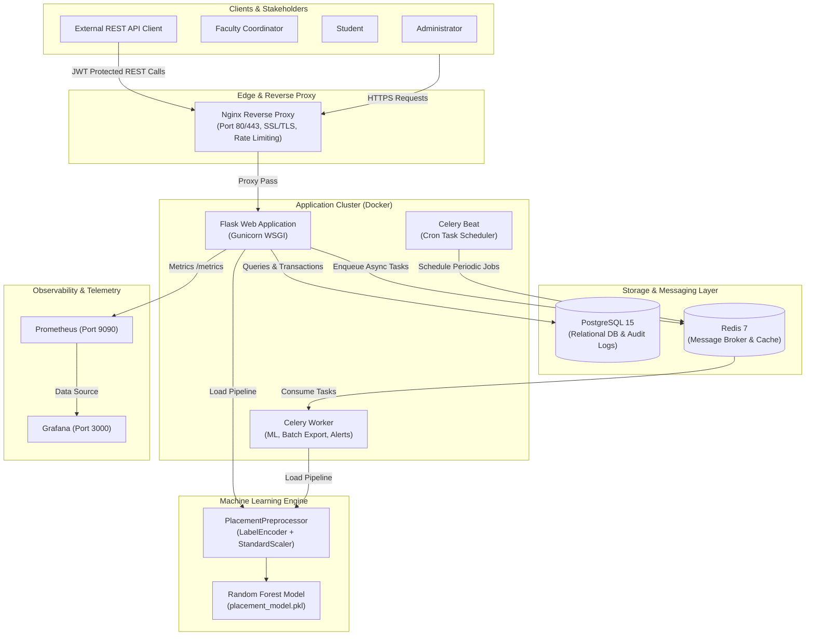

# 🎓 Smart Campus Placement Readiness Assessment & Prediction Portal

[](https://www.python.org/)
[](https://flask.palletsprojects.com/)
[](https://www.postgresql.org/)
[](https://redis.io/)
[](https://docs.celeryq.dev/)
[](https://www.docker.com/)
[](https://scikit-learn.org/)
[](https://nginx.org/)
[](https://prometheus.io/)
[](https://grafana.com/)
[](https://opensource.org/licenses/MIT)

An enterprise-grade, cloud-native microservices platform designed to monitor student academic progress, assess placement eligibility, and predict campus placement readiness using Machine Learning.

---

## 📌 Table of Contents

- [Overview](#-overview)
- [Key Features](#-key-features)
- [System Architecture](#-system-architecture)
- [Tech Stack](#-tech-stack)
- [Project Directory Structure](#-project-directory-structure)
- [Machine Learning Pipeline](#-machine-learning-pipeline)
- [Getting Started](#-getting-started)
  - [Prerequisites](#prerequisites)
  - [Quick Start with Docker (Recommended)](#quick-start-with-docker-recommended)
  - [Local Development Setup (Without Docker)](#local-development-setup-without-docker)
- [Default User Credentials](#-default-user-credentials)
- [Makefile Commands Cheatsheet](#-makefile-commands-cheatsheet)
- [REST API Endpoints](#-rest-api-endpoints)
- [Security & Hardening](#-security--hardening)
- [Testing & Quality Assurance](#-testing--quality-assurance)
- [Backup & Disaster Recovery](#-backup--disaster-recovery)
- [Detailed Academic Report](#-detailed-academic-report)
- [Contributing](#-contributing)
- [Author & License](#-author--license)

---

## 📖 Overview

University placement cells often struggle with fragmented academic records, slow manual candidate shortlisting, and reactive identification of at-risk students. 

The **Campus Placement Readiness Portal** solves these challenges through a centralized, high-availability platform that bridges academic metrics, technical competency, soft skills, and predictive artificial intelligence:
- **Predictive Intervention**: Uses an ensemble Random Forest model to calculate placement probability, allowing faculty to deliver timely upskilling before recruitment drives begin.
- **Asynchronous Architecture**: Leverages Celery and Redis to handle compute-intensive ML inference, batch imports, report generation, and email alerts in the background without degrading web UI performance.
- **Production Hardened**: Fully containerized with Docker Compose, Nginx reverse proxy with SSL termination and rate limiting, PostgreSQL 15, and Prometheus/Grafana observability.

---

## ✨ Key Features

- 🔐 **Role-Based Access Control (RBAC)**: Dedicated interfaces and fine-grained permissions for **Admins**, **Faculty Coordinators**, and **Students**.
- 🤖 **AI-Driven Placement Readiness Prediction**: Real-time evaluation of CGPA, backlogs, aptitude test scores, communication ratings, internships, and project counts using a versioned Random Forest classifier.
- ⚡ **Asynchronous Worker Queues**: Dedicated Celery worker queues (`prediction`, `export`, `notification`) backed by Redis.
- 📊 **Interactive Analytics & Reporting**: Department-wise breakdowns, placement statistics, customizable filters, and one-click data export to Excel and CSV.
- 📥 **Batch Import & Legacy Migration**: Bulk import student records via CSV/Excel, with automated validation and a migration utility for legacy JSON data.
- 📈 **Enterprise Observability**: End-to-end telemetry via `prometheus-flask-exporter` and visual system dashboards in Grafana.
- 🛡️ **Defensive Security**: CSRF protection, Flask-Limiter API throttling, bcrypt password hashing, JWT authentication for APIs, audit logging, and automated static vulnerability scanning with Bandit.
- 💾 **Automated Backups & Recovery**: Shell automation for zero-downtime PostgreSQL dumps and restoration.

---

## 🏗️ System Architecture



---

## 💻 Tech Stack

| Layer | Technology | Purpose |
| :--- | :--- | :--- |
| **Backend Framework** | Python 3.10+, Flask 2.3+ | Application routing, ORM integration, API services |
| **WSGI Server** | Gunicorn 21.2+ | Production-grade WSGI HTTP server |
| **Relational Database** | PostgreSQL 15, SQLAlchemy, Flask-Migrate | ACID transactions, relational schema, database migrations |
| **Message Broker & Cache** | Redis 7, Celery 5.3+ | Asynchronous task queue, background job management, caching |
| **Machine Learning** | Scikit-Learn, Pandas, NumPy, SDV | Random Forest classification, data preprocessing, synthetic generation |
| **Reverse Proxy & Gateway**| Nginx 1.25 Alpine | Reverse proxy, static asset delivery, SSL termination, rate limiting |
| **Frontend** | Jinja2, HTML5, CSS3, Bootstrap 5 | Responsive role-tailored web dashboards |
| **Monitoring & Telemetry** | Prometheus, Grafana | Request metrics, resource monitoring, system visualization |
| **Security & Auth** | Flask-Login, Flask-JWT-Extended, Flask-Limiter, Bleach | Authentication, session management, token security, sanitization |
| **DevOps & Containers** | Docker, Docker Compose, GNU Make | Multi-container orchestration, zero-configuration startup |
| **Testing & Auditing** | Pytest, Pytest-Cov, Bandit | Unit/integration testing, test coverage, static code security scanning |

---

## 📁 Project Directory Structure

```text
Placement/
├── backend/
│   ├── models/                  # SQLAlchemy ORM Models
│   │   ├── audit_log.py         # System action audit logging
│   │   ├── placement_record.py  # Placement offer and company tracking
│   │   ├── prediction_log.py    # Historical ML prediction logs
│   │   ├── student.py           # Core student profiles & academic data
│   │   └── user.py              # User authentication & role management
│   ├── routes/                  # Modular Flask Blueprints
│   │   ├── api.py               # REST API endpoints (JWT authenticated)
│   │   ├── auth.py              # Login, logout, password change
│   │   ├── dashboard.py         # Admin, Faculty, and Student dashboards
│   │   ├── placement.py         # Placement records & statistics
│   │   ├── predict.py           # ML inference triggers & views
│   │   ├── reports.py           # Departmental reports & data export
│   │   └── students.py          # Student CRUD, import & export
│   ├── services/                # Business Logic & Celery Services
│   │   ├── export.py            # CSV / Excel export service
│   │   ├── import_service.py    # Batch student data ingestion
│   │   ├── ml_predict.py        # ML prediction inference engine
│   │   ├── ml_tasks.py          # Celery asynchronous tasks & scheduling
│   │   └── notification.py      # Email dispatch service
│   ├── app.py                   # Application factory (create_app)
│   ├── config.py                # Environment configuration classes
│   ├── decorators.py            # Role-based access control decorators
│   ├── extensions.py            # Extensions (db, migrate, limiter, cache, mail)
│   └── forms.py                 # Flask-WTF validated form schemas
│
├── ml/                          # Machine Learning Pipeline
│   ├── cleaned_data.csv         # Benchmark training dataset
│   ├── generate_synthetic.py    # Synthetic dataset generator using SDV
│   ├── preprocess.py            # Custom Scikit-learn PlacementPreprocessor
│   ├── test_model.py            # Model validation & benchmark test suite
│   ├── train_model.py           # Model training, versioning & export script
│   └── model_versions/          # Timestamped model artifacts & metadata
│
├── monitoring/
│   └── prometheus.yml           # Prometheus scrape configurations
│
├── nginx/
│   └── nginx.conf               # Nginx reverse proxy configuration & rate limits
│
├── scripts/
│   ├── backup_db.sh             # Automated PostgreSQL backup script
│   ├── restore_db.sh            # Disaster recovery restoration script
│   ├── deploy.sh                # Production deployment script
│   ├── migrate_json.py          # Migration tool for legacy JSON data
│   └── seed_data.py             # Database seeder (Admin, Faculty, Students)
│
├── static/                      # Static assets (CSS, JS, images)
├── templates/                   # Jinja2 HTML templates organized by module
├── tests/                       # Pytest test suites (API, Auth, ML, Security)
├── .env.example                 # Environment variable template
├── docker-compose.yml           # Multi-container orchestration specification
├── Dockerfile                   # Optimized multi-stage Docker build
├── Makefile                     # Command-line developer shortcuts
├── MICROPROJECT_REPORT.md       # Full 900+ line academic & architectural report
├── requirements.txt             # Python dependency manifest
└── wsgi.py                      # Application entry point for Gunicorn
```

---

## 🧠 Machine Learning Pipeline

### 1. Feature Specifications

The model evaluates seven key academic and experiential indicators:

| Feature Name | Type | Description |
| :--- | :---: | :--- |
| `department` | Categorical | Engineering stream (`CSE`, `ECE`, `MECH`, `CIVIL`, `IT`, etc.) |
| `cgpa` | Float | Cumulative Grade Point Average (`0.0` - `10.0`) |
| `backlog_count` | Integer | Number of active or historical backlogs |
| `communication_score` | Float | Soft skill & interview communication rating (`0` - `100`) |
| `aptitude_score` | Float | Quantitative & analytical aptitude test score (`0` - `100`) |
| `internships` | Integer | Count of completed technical internships |
| `projects` | Integer | Count of major academic or open-source projects |

### 2. Preprocessing & Classifier

The training workflow is structured as an end-to-end Scikit-learn `Pipeline`:
1. **`PlacementPreprocessor`**:
   - Applies `LabelEncoder` with unseen-label fallback to `department`.
   - Normalizes numerical columns with `StandardScaler`.
2. **`RandomForestClassifier`**:
   - `n_estimators=100`, `random_state=42`.
   - Generates placement probability scores (`0.0` - `1.0`) and binary classification (`Placed` vs `Unplaced`).
3. **Model Versioning**:
   - Every training execution produces a timestamped artifact in `ml/model_versions/placement_model_<timestamp>.pkl` with companion `metadata_<timestamp>.json` recording training accuracy, date, and sample count.
   - Automatically updates the production reference `ml/placement_model.pkl`.

---

## 🚀 Getting Started

### Prerequisites

Ensure you have the following installed on your system:
- **Docker 24+** and **Docker Compose v2** (Recommended)
- *Alternatively for bare-metal:* **Python 3.10+**, **PostgreSQL 15**, and **Redis 7**

---

### Quick Start with Docker (Recommended)

1. **Clone the repository:**
   ```bash
   git clone https://github.com/MaheshwaranCSE/Placement.git
   cd Placement
   ```

2. **Configure Environment Variables:**
   ```bash
   cp .env.example .env
   ```
   *(Update `.env` with secure secrets, database passwords, and SMTP details if required).*

3. **Build and start all services:**
   ```bash
   make up
   ```
   *Or with Docker Compose directly:*
   ```bash
   docker-compose up -d --build
   ```

4. **Initialize database schema & migrations:**
   ```bash
   make migrate
   ```

5. **Seed the database with initial users and test records:**
   ```bash
   make seed
   ```

6. **Access the Application:**
   - **Main Web Portal**: [http://localhost/](http://localhost/)
   - **Prometheus Metrics**: [http://localhost:9090](http://localhost:9090)
   - **Grafana Dashboard**: [http://localhost:3000](http://localhost:3000)

---

### Local Development Setup (Without Docker)

1. **Create and activate a virtual environment:**
   ```bash
   python -m venv venv
   source venv/bin/activate   # On Windows: venv\Scripts\activate
   ```

2. **Install dependencies:**
   ```bash
   pip install -r requirements.txt
   ```

3. **Configure local environment variables:**
   Set `DATABASE_URL` pointing to your local PostgreSQL instance and `REDIS_URL` to your local Redis server.

4. **Run migrations and seed data:**
   ```bash
   flask db upgrade
   python scripts/seed_data.py
   ```

5. **Start Celery worker (in a separate terminal):**
   ```bash
   celery -A backend.services.ml_tasks worker --loglevel=info -Q prediction,export,notification
   ```

6. **Start the Flask development server:**
   ```bash
   python wsgi.py
   ```

---

## 🔑 Default User Credentials

After running `make seed`, log in using the following pre-configured credentials:

| Role | Username | Default Password | Dashboard Permissions |
| :--- | :--- | :--- | :--- |
| **Admin** | `admin` | `admin123#Secure` *(or `ADMIN_PASSWORD` in `.env`)* | Full system access, user management, global analytics |
| **Faculty (CSE)** | `faculty_cse` | `faculty#Password1` | Department student list, predictions, reports |
| **Faculty (ECE)** | `faculty_ece` | `faculty#Password1` | Department student list, predictions, reports |
| **Student** | `23CSE101` | *Created via admin/seed* | Personal profile, placement readiness status |

---

## 🛠️ Makefile Commands Cheatsheet

The project includes a `Makefile` providing quick shortcuts for everyday administrative tasks:

| Command | Action |
| :--- | :--- |
| `make up` | Builds and starts all Docker containers in background mode |
| `make down` | Gracefully terminates and removes running containers |
| `make logs` | Streams live logs from `web` and `celery_worker` containers |
| `make migrate` | Applies latest SQLAlchemy database migrations (`flask db upgrade`) |
| `make seed` | Populates database with default Admin, Faculty, and sample Student records |
| `make migrate_json` | Migrates legacy JSON student data into PostgreSQL |
| `make backup` | Executes automated PostgreSQL database dump via `scripts/backup_db.sh` |
| `make test` | Executes Pytest test suite with code coverage report (`pytest --cov=backend`) |
| `make lint` | Performs static security audit using Bandit (`bandit -r backend/`) |
| `make shell` | Opens interactive Flask application shell context |
| `make superuser` | Creates or recovers the primary system Administrator account |

---

## 📡 REST API Endpoints

The system exposes a secure REST API versioned under `/api/v1` for integration with external campus portals:

| Method | Endpoint | Auth | Description |
| :---: | :--- | :---: | :--- |
| `POST` | `/api/v1/auth/token` | Public (Rate Limited) | Exchanges `username` and `password` for a JWT Bearer access token |
| `GET` | `/api/v1/students` | JWT Required | Returns paginated list of students (`page`, `per_page=25`) |
| `POST` | `/api/v1/students` | JWT Required | Registers a new student profile |
| `GET` | `/api/v1/predict/status/<task_id>` | JWT Required | Checks the status and retrieves result of an async prediction job |

---

## 🔒 Security & Hardening

- **Protection Against Injections**: 100% parameterised queries using SQLAlchemy ORM to prevent SQL injection.
- **CSRF Defense**: All form submissions enforce encrypted CSRF tokens generated by Flask-WTF.
- **DDoS & Brute-Force Mitigation**: Endpoint throttling via `Flask-Limiter` (e.g., token endpoint restricted to `10/min`).
- **XSS Sanitization**: User-submitted textual input is sanitized using `Bleach`.
- **Credential Storage**: Passwords hashed using salted `bcrypt` algorithms.
- **Automated Security Auditing**: Monitored via Bandit AST vulnerability scanning (`make lint`).

---

## 🧪 Testing & Quality Assurance

A comprehensive test suite covers authentication, role authorization, REST APIs, and machine learning pipelines:

```bash
# Run tests inside Docker
make test

# Run tests locally
pytest --cov=backend tests/
```

Test coverage includes:
- `tests/test_auth.py`: Session management, password hashing, unauthorized access blocks.
- `tests/test_security.py`: CSRF validation, XSS prevention, rate limiting triggers.
- `tests/test_predict.py`: Model inference precision, missing value handling, edge case evaluation.
- `tests/test_api.py`: JWT token lifecycle and authenticated route contracts.
- `tests/test_students.py`: Student profile creation, updates, and pagination.

---

## 💾 Backup & Disaster Recovery

### Automated Daily Backups
The database container is equipped with an automated backup utility in `scripts/backup_db.sh`. To configure a daily backup cron job on your host server:
```bash
0 2 * * * make -C /opt/campus_placement backup
```

### Database Restoration
To restore from a backup snapshot:
```bash
docker-compose exec -T postgres /backup/restore_db.sh /var/backups/placement_db_backup_<timestamp>.sql.gz
```

---

## 📄 Detailed Academic Report

For in-depth research methodology, complete mathematical formulas, AWS infrastructure configurations, and extensive test case screenshots, refer to the [**Microproject Report**](MICROPROJECT_REPORT.md).

---

## 🤝 Contributing

Contributions are welcome! Please follow these steps:
1. Fork the Project repository
2. Create your Feature Branch (`git checkout -b feature/NewFeature`)
3. Commit your Changes (`git commit -m "feat: Add NewFeature"`)
4. Run tests and linting (`make test && make lint`)
5. Push to the Branch (`git push origin feature/NewFeature`)
6. Open a Pull Request

---

## 👨‍💻 Author & License

- **Maheshwaran S** - [MaheshwaranCSE](https://github.com/MaheshwaranCSE)
- Licensed under the **MIT License**. See `LICENSE` for details.
